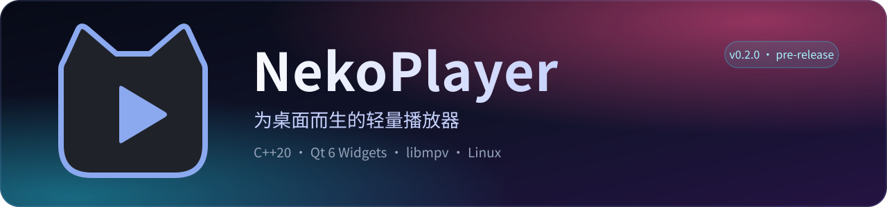
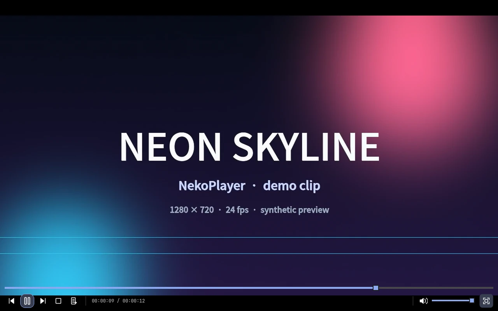
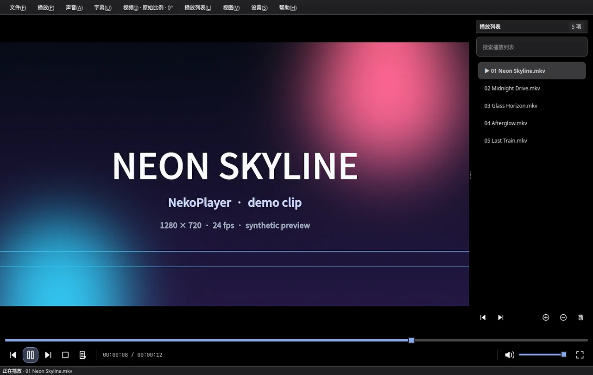
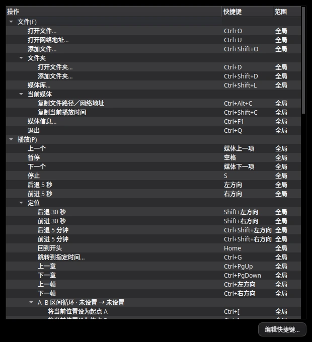
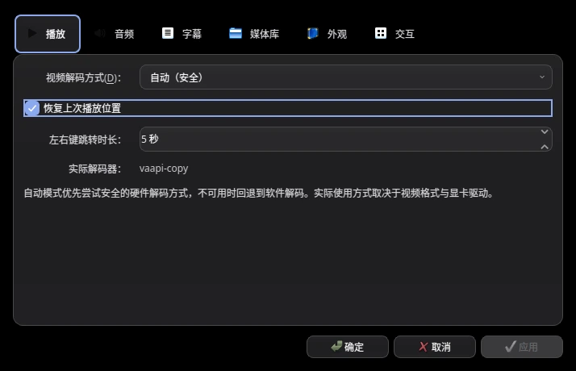
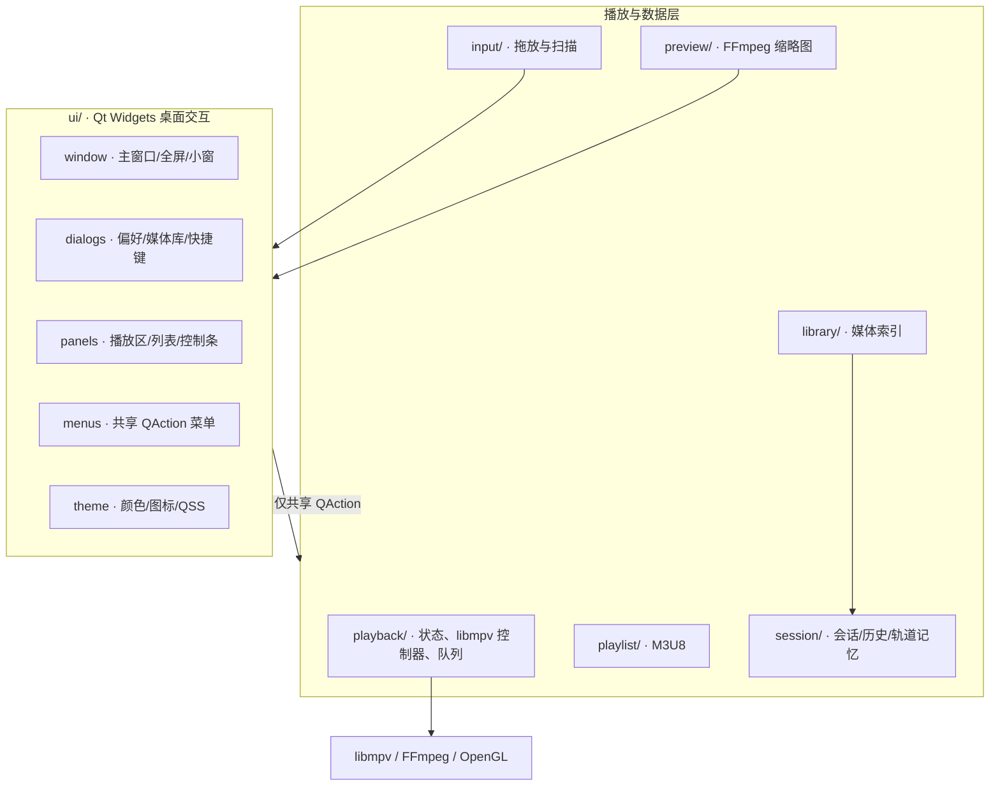

<p align="center">
  
</p>

<p align="center">
  <a href="https://github.com/NekoRain404/NekoPlayer/actions/workflows/ci.yml"></a>
  
  
  
  
  
</p>

<p align="center">
  打开即播的 Linux 桌面播放器 · PotPlayer 式紧凑交互 · <b>C++20 / Qt 6 Widgets / libmpv</b>
</p>



NekoPlayer 用原生 Qt Widgets 承载界面、用 libmpv 负责解码与渲染，目标是把“双击文件就能舒服看完”的体验做扎实：完整的播放与定位、可编辑快捷键、音轨/字幕选择、播放列表与媒体库、会话续播，以及不抢戏的深色界面。当前版本为 **v0.2.0 pre-release**，面向 Linux 桌面；Windows 与原生 HDR 验收仍在路线图上。

## 亮点

| | 能力 | 你能得到什么 |
| --- | --- | --- |
| ▶ | **原生播放** | QOpenGLWidget + libmpv render API；硬解、HDR 色调映射、去隔行、逐帧、A–B 循环和睡眠定时器都在同一条渲染路径上 |
| 🎚 | **声音与字幕** | 多音轨/外挂音轨、内嵌与外挂字幕、字幕样式（颜色/描边/背景/编码）、均衡器、锐化与降噪、按媒体记忆倍速和延迟 |
| 📚 | **队列与媒体库** | 拖放、文件夹递归扫描、多选与排序、缺失文件清理、UTF-8 M3U8（保留 `#EXTINF` 标题与时长）、监视文件夹与搜索 |
| ⌨ | **可编辑快捷键** | F1 实时快捷键参考；选择动作后设置/清除/恢复默认，按作用域校验冲突并持久化 |
| 🪟 | **桌面手感** | 深色玻璃质感、五种强调色、可调透明度与模糊层次、全屏/小窗、窗口置顶、单实例转发 |
| 💾 | **会话与恢复** | 队列、当前行、播放位置、音量、窗口状态、最近 100 个文件的续播位置和按媒体轨道记忆；原子写、版本化、损坏文件保留原样 |

## 界面

| 播放与播放列表 | 快捷键参考 |
| --- | --- |
|  |  |

<p align="center">
  
</p>

界面截图来自本仓库在 Xvfb + 软件 OpenGL 下的真实运行；演示媒体为生成的测试画面，不包含第三方素材。

## 快速开始

**依赖**：CMake 3.25+、Ninja、C++20 编译器、Qt 6.5+（Core/Concurrent/Widgets/OpenGLWidgets/LinguistTools）、libmpv 与 FFmpeg 开发库、pkg-config。Arch 用户可使用 `packaging/arch/PKGBUILD`；它已更新到最近发布的 **v0.2.0-rc1** 源码归档与校验和。

```bash
cmake --preset debug
cmake --build --preset debug
ctest --preset debug          # 自动注入 LC_ALL=C / LANG=C
./build/debug/NekoPlayer
./build/debug/NekoPlayer --check-backend
./build/debug/NekoPlayer '/path/电影 example.mkv' 'https://example.org/video.mkv'
```

常用选项：`--fullscreen` 启动即全屏，`--start-paused` 首帧暂停，`--no-config` 不读写配置，`--smoke-test` 初始化后退出。X11 回归使用 `debug-x11` 预设；sanitizer 预设见 [开发指南](docs/development.md)。安装：

```bash
cmake --install build/debug --prefix ~/.local
```

## 常用快捷键

| 操作 | 快捷键 | 操作 | 快捷键 |
| --- | --- | --- | --- |
| 打开文件 | Ctrl+O | 播放/暂停 | 空格 |
| 打开网络地址 | Ctrl+U | 停止 | S |
| 添加文件 / 显示列表 | Ctrl+Shift+O / Ctrl+L | 上一项 / 下一项 | 多媒体键 |
| 打开 / 添加文件夹 | Ctrl+D / Ctrl+Shift+D | 后退 / 前进 | ← / → |
| 加/减音量 | ↑ / ↓ | 静音 | M |
| 全屏 / 退出 | F / Esc | 小窗 | Ctrl+Shift+M |
| 加载字幕 / 音轨 | Ctrl+Shift+S / Ctrl+Shift+A | 显示/隐藏字幕 | V |
| 偏好设置 | F5 / F6 | 媒体信息 | Ctrl+F1 |
| 截图 | Ctrl+E / Ctrl+Alt+E | 媒体库 | Ctrl+Shift+L |
| 快捷键参考 | F1 | 快速操作 | Ctrl+K |

完整快捷键、菜单路径与逐项行为见 [功能参考](docs/features.md#快捷键)。

## 架构



界面不直接发原始 mpv 命令；播放状态、图形资源与桌面交互分层。详细组件职责、线程与生命周期约束见 [架构说明](docs/architecture.md)。

## 项目状态与路线图

- **v0.2.0-rc1 pre-release**（[发布页](https://github.com/NekoRain404/NekoPlayer/releases/tag/v0.2.0-rc1)）：媒体库、快捷键编辑、字幕样式、均衡器与视频滤镜、按媒体调优、睡眠定时器、单实例、图片媒体、M3U8 `#EXTINF` 元数据，以及 2026-10-28 审计整改。
- **验证**：Linux Wayland 桌面上的 89 项 CTest（含窗口集成）全部通过；X11 预设通过 Xvfb + Openbox 回归。测试计数与逐轮证据记录在 [验证记录](docs/verification.md)，不在 README 中固化。
- **边界**：原生 Wayland HDR 输出、真实 GPU 硬解、多显示器混合缩放、物理音频设备与 Windows 打包仍需实机验收；字幕在线搜索/下载明确推迟。

路线图：

- [x] Linux 可播放版本与 Arch 打包（v0.1.0）
- [x] 媒体库、快捷键编辑、字幕样式、音视频效果与审计整改（v0.2.0-rc1）
- [x] 标签驱动的源码归档、校验和与 Arch 打包跟进
- [ ] 原生 Wayland HDR / 硬件解码 / 多显示器实机验收
- [ ] 字幕搜索与下载、Windows 构建
- [ ] 可复现构建与更多架构的发布证据

## 文档

| 文档 | 内容 |
| --- | --- |
| [功能参考](docs/features.md) | 逐项行为、边界与完整快捷键 |
| [开发指南](docs/development.md) | 构建/测试/目录结构/约定/发布 |
| [架构说明](docs/architecture.md) | 分层边界、线程、渲染与持久化 |
| [文档索引](docs/README.md) | 全部文档与历史归档入口 |
| [验证记录](docs/verification.md) | 按日期的构建、测试与真机验证 |
| [更新日志](CHANGELOG.md) | 版本变更 |
| [贡献指南](CONTRIBUTING.md) · [安全策略](SECURITY.md) | 参与开发与漏洞报告 |

## 许可证

NekoPlayer 以 **GPL-3.0-only** 发布（见 [LICENSE](LICENSE)）。运行时链接系统 FFmpeg 与 libmpv；分发二进制前请重新核对依赖许可证，详见 [打包说明](docs/packaging.md#license)。
